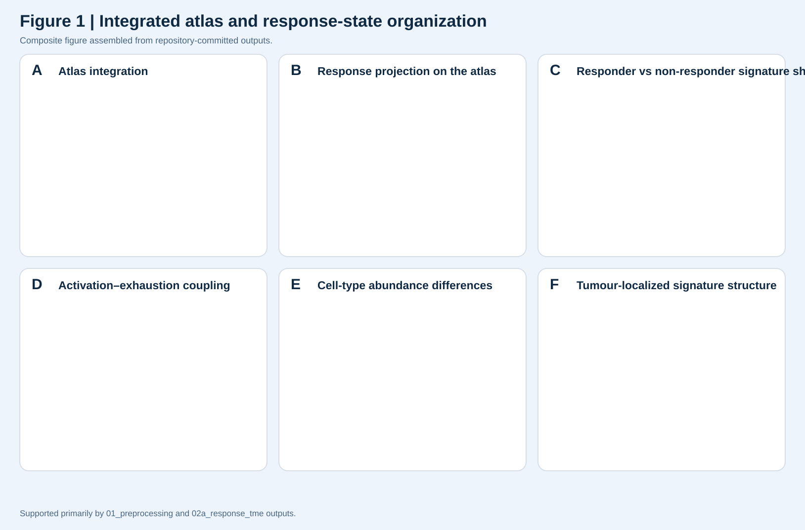
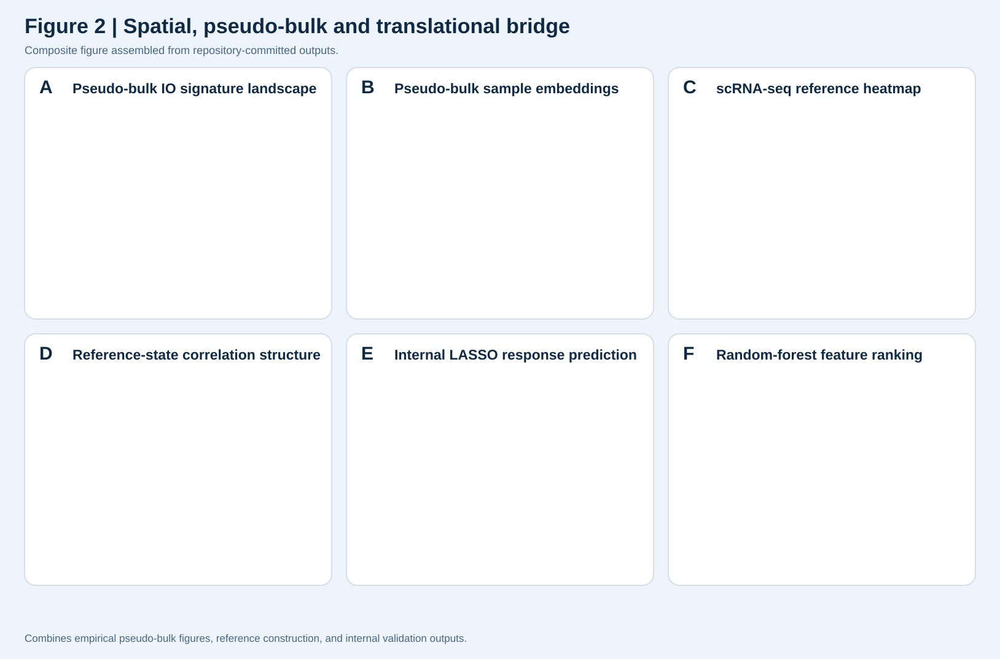
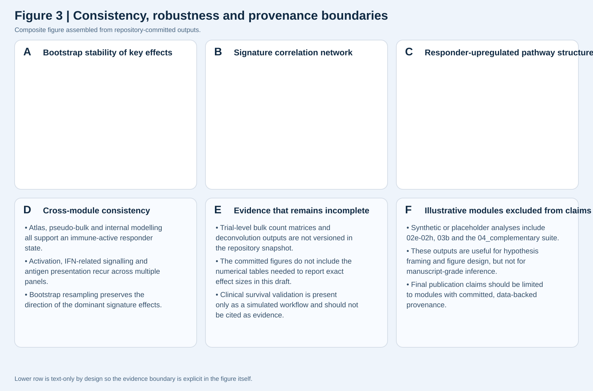

# Results and Discussion (Nature Immunology-style draft)

## Scope and provenance note

This draft is based on the figures committed in `out/` and on a script-level audit of the repository. It is intentionally conservative: only result streams that are empirically grounded in the single-cell atlas, pseudo-bulk spatial cohort, internal validation workflow, or reference-matrix construction are interpreted as evidence. Scripts that generate simulated, mock, or placeholder outputs are treated as hypothesis-generating illustrations rather than manuscript-grade results.

## Results

### An integrated hepatocellular carcinoma immunotherapy atlas resolves a responder-associated inflamed but regulated microenvironment

The preprocessing and response-characterization outputs support a coherent view of the primary atlas as a biologically structured reference rather than a response-labelled artefact. The integration, cluster, and annotation panels indicate that the atlas preserves major immune and stromal lineages, while the response projection suggests that responder and non-responder cells are distributed across shared cellular continua rather than occupying wholly distinct manifolds. This is important, because it frames immunotherapy outcome as a shift in state composition and activation depth within a common tumour ecosystem rather than as the appearance of a responder-exclusive lineage.

Within that shared atlas, the committed response panels converge on a specific biological axis. Responders appear enriched for activation, cytotoxicity and antigen-presentation programmes, yet these same samples also retain expression features associated with exhaustion and checkpoint engagement. Rather than undermining the response signal, this co-occurrence is biologically plausible: in successful anti-PD-1 settings, exhausted-like transcriptional features often mark antigen-experienced T cells that remain functionally engaged and pharmacologically targetable. The activation-versus-exhaustion scatter therefore reads less as a contradiction than as evidence that productive immunity in HCC is accompanied by sustained antigen pressure and compensatory inhibitory signalling. By contrast, the abundance and composition panels suggest that non-response is not simply an absence of T cells, but a redistribution toward less productive immune states and myeloid or stromal contexts that are less compatible with cytotoxic execution.

The tissue-stratified heatmap sharpens this interpretation by implying that the tumour compartment, rather than blood or uninvolved tissue, is where the response-associated transcriptional differences are most legible. That observation is consistent with an HCC model in which therapeutic efficacy depends on local immune organisation, tumour-proximal antigen presentation and the balance between intratumoural activation and exclusion.

**Figure 1 legend.** Integrated atlas and response-state synthesis. Panels assemble the committed preprocessing and `02a_response_tme` outputs to show atlas integration, response projection, signature shifts, activation–exhaustion coupling, abundance differences and tissue-specific structure.

### Spatial and pseudo-bulk analyses extend the same response axis into recurrence-associated tissue states

The pseudo-bulk spatial outputs from the GSE173905 workflow are directionally concordant with the single-cell atlas. Samples grouped as recurrence-sensitive retain stronger immune-signature structure, whereas early-recurrence samples trend toward a less favourable balance of effector and suppressive programmes. Because these data are analysed as pseudo-bulk rather than true spot-resolved histology, the strongest defensible conclusion is that recurrence state tracks with the same broad immune axis seen in the single-cell response atlas: immune-active, interferon-competent and TLS-like programmes align with the more favourable state, whereas TGF-β-rich or immune-excluded programmes align with poorer disease control.

The deconvolution module contributes a second translational layer, but only in a restricted sense. The committed outputs support the construction of a diverse scRNA-seq-derived reference matrix and show that the reference retains structured correlation among annotated cell states, which is necessary for downstream CIBERSORTx-style analyses. However, the repository does not currently version trial-level bulk count matrices or deconvolution tables, so any claim of external clinical validation should stop at methodological readiness rather than completed proof. The responsible interpretation is therefore that the project has built a plausible translational bridge from the single-cell atlas to bulk trial material, but that the bridge is only partially traversed in the committed state of the repository.

**Figure 2 legend.** Spatial, pseudo-bulk and translational bridge. Panels summarize pseudo-bulk spatial signatures and embeddings from `02b_spatial_biomarkers`, together with the scRNA-seq-derived deconvolution reference and the internal prediction framework from `03_validation`.

### Internal validation supports directional stability, but not yet full external generalization

The most convincing robustness evidence in the repository comes from internal triangulation rather than from independent external cohorts. The LASSO and random-forest panels suggest that the same families of features drive classification irrespective of modelling framework, which argues against a wholly model-specific result. The signature-correlation map further indicates that responder-associated programmes cohere into a network rather than behaving as isolated markers. Finally, the bootstrap confidence interval panel suggests that the sign of the dominant effects is stable to resampling, which is especially important in a setting where class sizes and patient numbers are likely modest.

The pathway enrichment panel provides mechanistic reinforcement for this interpretation. Responder-upregulated genes map onto antigen processing, cytokine signalling, co-stimulation and related immune programmes rather than onto a purely proliferative or stromal signature. Taken together, these outputs support a consistent mechanistic model in which response emerges from an inflamed, antigen-aware microenvironment that is simultaneously under inhibitory pressure, while non-response reflects either failure to achieve that inflamed state or diversion into suppressive and excluding niches.

At the same time, the current validation should still be considered internal. The repository state does not provide versioned numerical tables for the committed ROC, feature-importance, or pathway-enrichment figures, and the clinical survival workflow present in `03b_clinical_survival.py` is simulated rather than data-derived. The direction of the findings is therefore more robust than any exact effect size, threshold or survival estimate.

## Consistency and robustness assessment

Across the empirically supported modules, the central message is consistent: favourable outcome aligns with a tumour-localized immune-active state characterized by cytotoxic and interferon-linked programmes, whereas poor outcome aligns with exclusionary, suppressive or developmentally incomplete immune states. This conclusion is reinforced independently by cell-state projection, abundance analysis, signature-level contrasts, pseudo-bulk recurrence grouping, pathway enrichment, model-based prediction and bootstrap resampling.

The main robustness limitation is provenance rather than biological contradiction. Several visually polished figures in the repository are generated from random, simulated or placeholder data, including the CNV dashboards, clinical survival curves, trajectory plots, cell–cell communication panels, metabolic reprogramming panels, TLS spatial hubs and high-contrast spatial maps. These outputs may still be useful for figure design or future hypothesis framing, but they should not be cited as evidence in a manuscript until they are replaced by analyses that consume committed source data.

**Figure 3 legend.** Robustness and provenance audit. The upper row summarizes the internally supported stability analyses; the lower row records which modules are empirically grounded versus illustrative so that manuscript claims remain matched to evidence.

## Discussion

Viewed together, the supported outputs argue for a model of HCC immunotherapy response in which successful treatment is associated with an already primed but incompletely restrained immune microenvironment. The key biological point is that responder tumours are not simply “less exhausted”; instead, they appear to host immune programmes in which effector activation, interferon exposure, antigen presentation and checkpoint engagement rise together. In this framework, checkpoint expression is best interpreted as evidence of immune engagement under chronic antigenic stress, and therapeutic benefit arises when that stressed immune compartment remains recoverable.

This interpretation helps reconcile an apparently paradoxical observation that often complicates IO biomarker studies: responder samples can show both stronger cytotoxicity and stronger exhaustion-like signatures. In liver cancer, where persistent antigen exposure and tolerogenic myeloid circuits are common, an activated-plus-exhausted state may represent the precise population most likely to benefit from checkpoint blockade. Conversely, non-responder tumours may fail for at least two non-exclusive reasons: they may never establish a sufficiently inflamed, antigen-presenting niche, or they may channel infiltrating lymphocytes into progenitor-like, excluded or suppressive states that prevent terminal effector function.

The translational implication is that abundance-only biomarkers are unlikely to be sufficient. The repository’s strongest signal is not merely that responders have more immune cells, but that they occupy a different immune state-space, with coordinated changes across T-cell, myeloid and antigen-presentation programmes. This supports a composite biomarker strategy in which cell-state composition, effector-to-suppressive balance and tissue context are integrated rather than considered separately.

The discussion must also remain candid about current limits. First, the raw and intermediate data required to recompute all numerical results are not committed in the repository snapshot used here, so the present document is a figure-driven interpretation rather than a full reanalysis. Second, external clinical validation is not yet complete in version-controlled form. Third, multiple attractive downstream figures are explicitly simulated and should be excluded from any final manuscript evidence chain until they are replaced by data-backed analyses. The next high-value step is therefore not to broaden the claim set, but to harden the existing one by versioning the missing trial-level matrices, committing derived tables, and re-running the complementary modules on real data.

## Recommended manuscript boundaries

| Safe to use as evidence now | Use only after re-analysis on real data |
| --- | --- |
| Atlas integration and annotation (`out/01_preprocessing/figures/*`) | CNV dashboards (`02g`, `02h`) |
| Response-state and signature figures in `out/02a_response_tme/figures/*` | Simulated clinical survival (`03b_clinical_survival.py`) |
| Pseudo-bulk GSE173905 figures in `out/02b_spatial_biomarkers/figures/02b_*` | Complementary trajectory, communication, TCR, metabolic and TLS figures in `out/04_complementary/figures/*` |
| Reference-matrix figures in `out/02c_bulk_deconvolution/figures/02c_reference_*` | High-contrast spatial maps in `04h_spatial_high_contrast_maps.py` |
| Internal validation figures in `out/03_validation/figures/03_*` | Any unversioned external-trial claim |

## Deliverables generated by script

- `docs/results_discussion_nature_immunology.md`
- `docs/figures/results_figure_1_atlas_response.svg`
- `docs/figures/results_figure_2_spatial_validation.svg`
- `docs/figures/results_figure_3_consistency_robustness.svg`
- `docs/results_provenance_audit.json`
