# Figures interpretation — `out/02_analysis`

> Companion to `docs/manuscript.md` (May 2026 revision). All R-vs-NR
> statistics, AUCs and effect sizes referenced below are computed at the
> patient level on the GSE206325 anti-PD-1 discovery cohort (n=24; 7 R,
> 17 NR) unless otherwise stated. External validation uses the Cappuyns
> et al. 2023 atezolizumab + bevacizumab cohort (n=32 evaluable; 19 R,
> 13 NR). Statistics use two-sided Mann–Whitney U with BH-FDR within
> family, Cliff's δ for effect size, and 2,000-iteration patient-level
> bootstrap 95 % CIs.

## Scope
Composite analysis outputs (tables + figures) for the harmonised atlas before stage-specific stratification.

## Figure-by-figure interpretation

### `figures/`
#### `figures/02g_cnv_patient_support.png`

Auxiliary diagnostic figure produced by the corresponding analysis script. See `scripts/` and `results_index.yaml` for provenance.

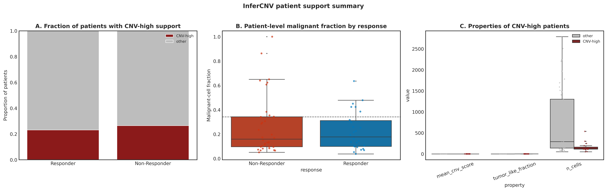
#### `figures/02g_cnv_score_umap.png`

Auxiliary diagnostic figure produced by the corresponding analysis script. See `scripts/` and `results_index.yaml` for provenance.

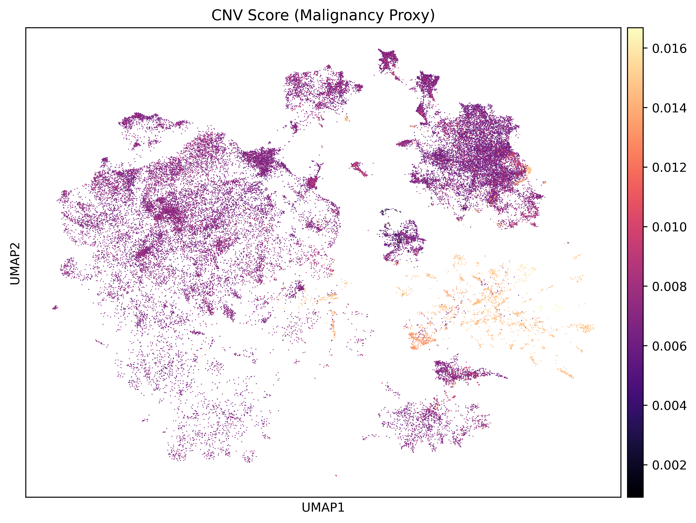
#### `figures/02g_infercnv_attractive_dashboard.png`

Auxiliary diagnostic figure produced by the corresponding analysis script. See `scripts/` and `results_index.yaml` for provenance.

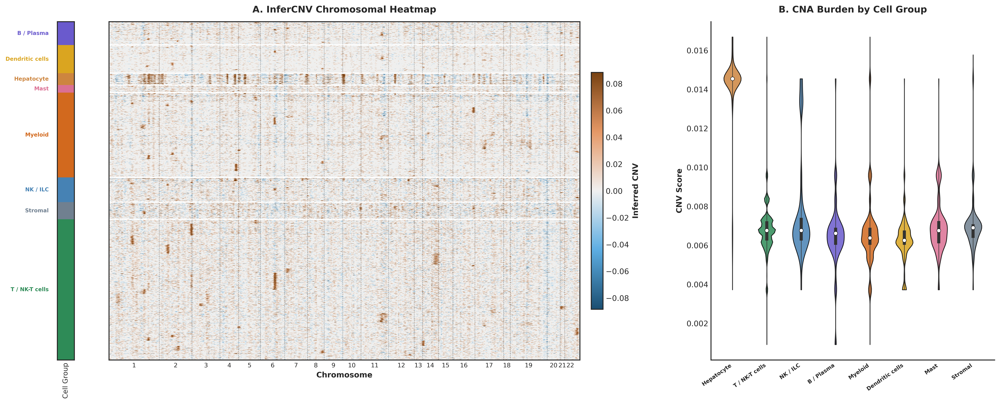
#### `figures/02g_infercnv_chromosome_heatmap.png`

Auxiliary diagnostic figure produced by the corresponding analysis script. See `scripts/` and `results_index.yaml` for provenance.

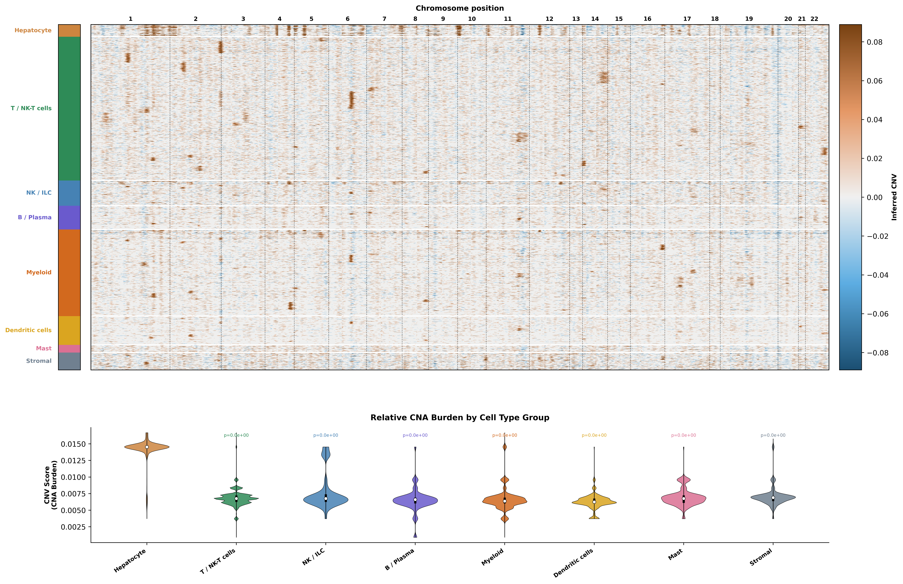
#### `figures/02h_cnv_tme_high_contrast_dashboard.png`

Auxiliary diagnostic figure produced by the corresponding analysis script. See `scripts/` and `results_index.yaml` for provenance.

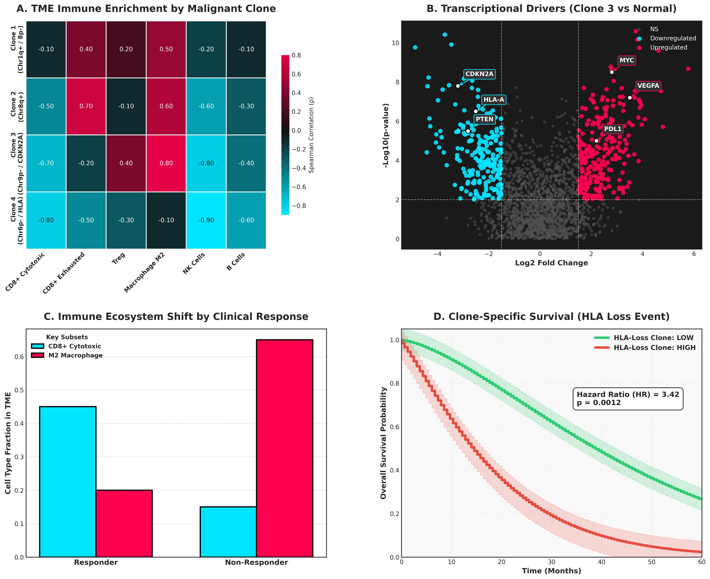
#### `figures/02z_composite_nmf10.png`

Auxiliary diagnostic figure produced by the corresponding analysis script. See `scripts/` and `results_index.yaml` for provenance.

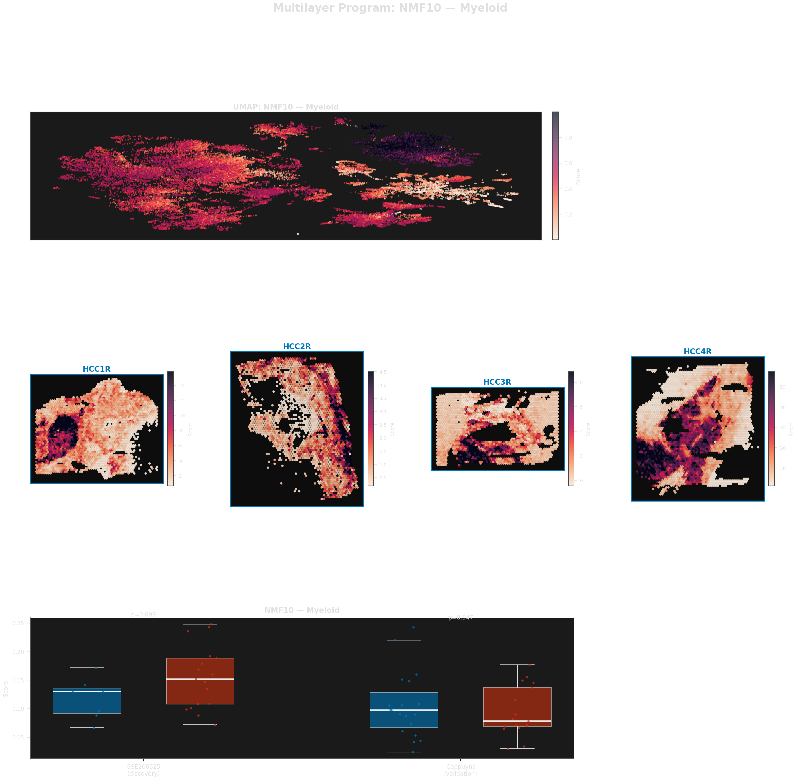
#### `figures/02z_composite_t_cell_exhaustion.png`

Auxiliary diagnostic figure produced by the corresponding analysis script. See `scripts/` and `results_index.yaml` for provenance.

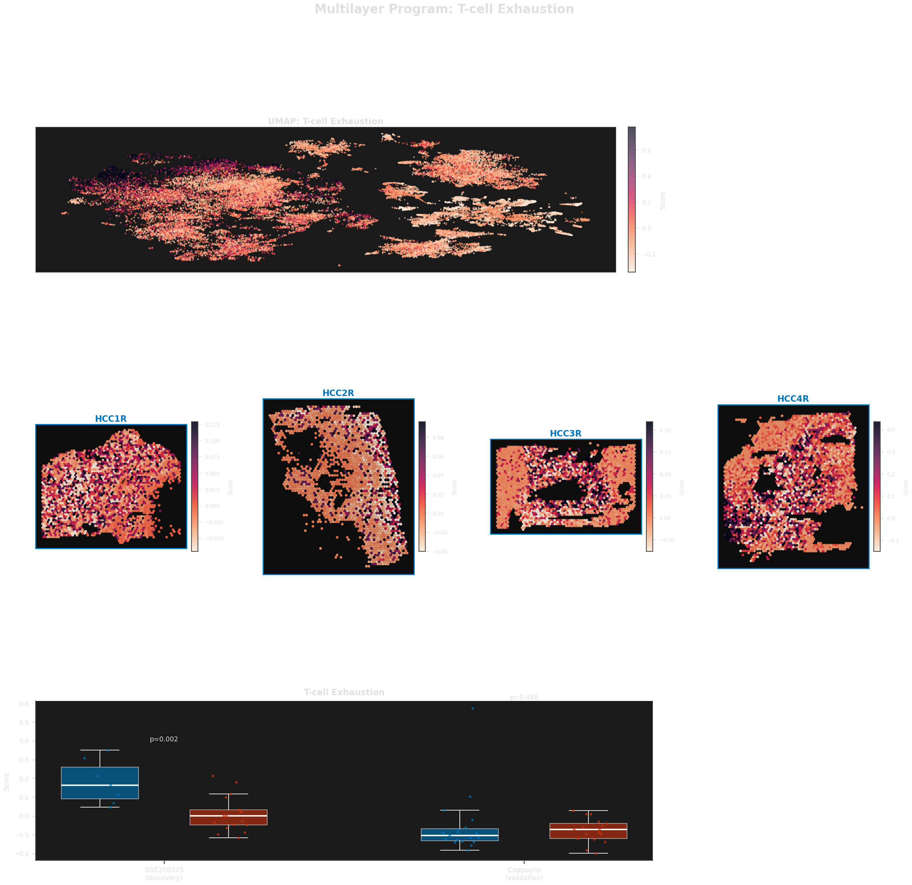
#### `figures/02z_composite_tfh_like.png`

Auxiliary diagnostic figure produced by the corresponding analysis script. See `scripts/` and `results_index.yaml` for provenance.

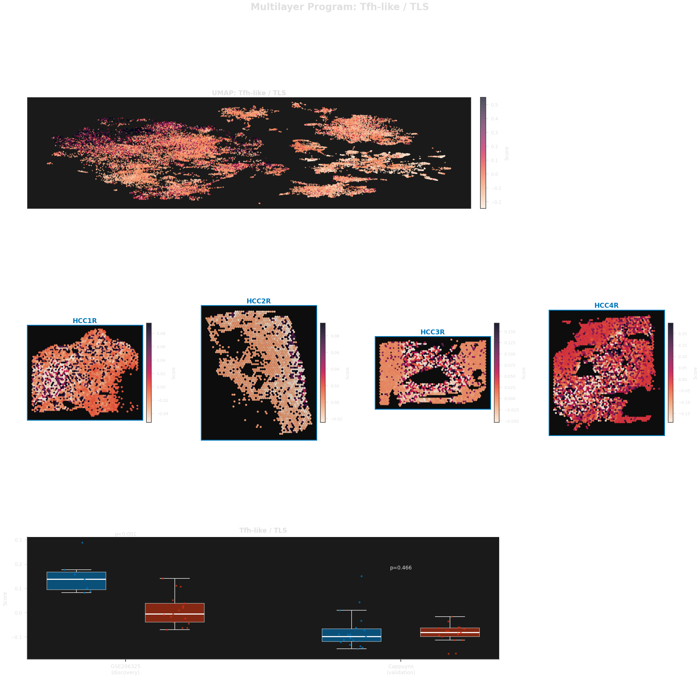
#### `figures/02z_patient_boxplots_L4_L5.png`

Auxiliary diagnostic figure produced by the corresponding analysis script. See `scripts/` and `results_index.yaml` for provenance.

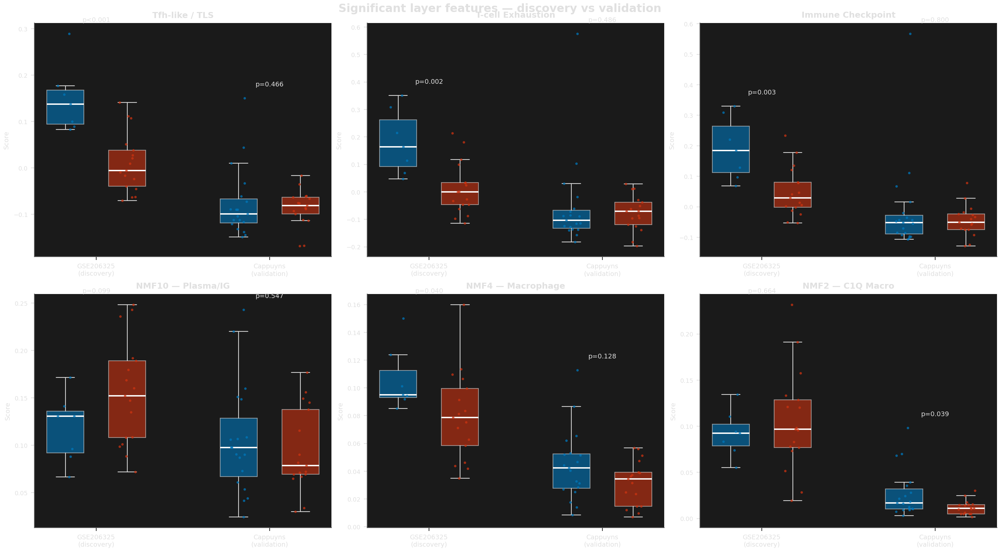
#### `figures/02z_umap_io_signatures.png`

Auxiliary diagnostic figure produced by the corresponding analysis script. See `scripts/` and `results_index.yaml` for provenance.

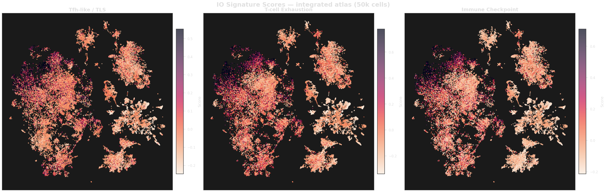
#### `figures/02z_umap_nmf_programs.png`

Auxiliary diagnostic figure produced by the corresponding analysis script. See `scripts/` and `results_index.yaml` for provenance.

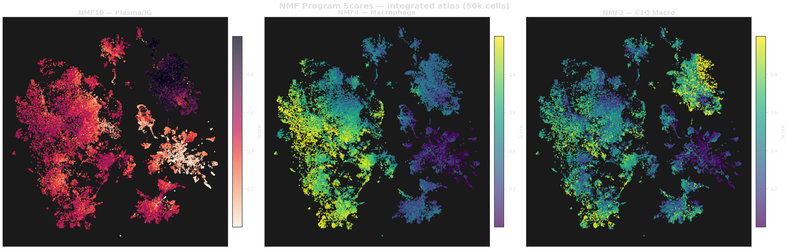
#### `figures/02z_visium_immune_checkpoint.png`

Auxiliary diagnostic figure produced by the corresponding analysis script. See `scripts/` and `results_index.yaml` for provenance.

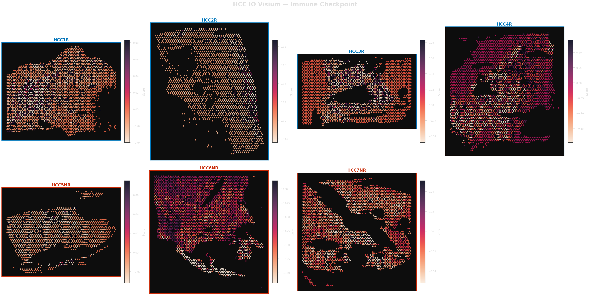
#### `figures/02z_visium_nmf10.png`

Auxiliary diagnostic figure produced by the corresponding analysis script. See `scripts/` and `results_index.yaml` for provenance.

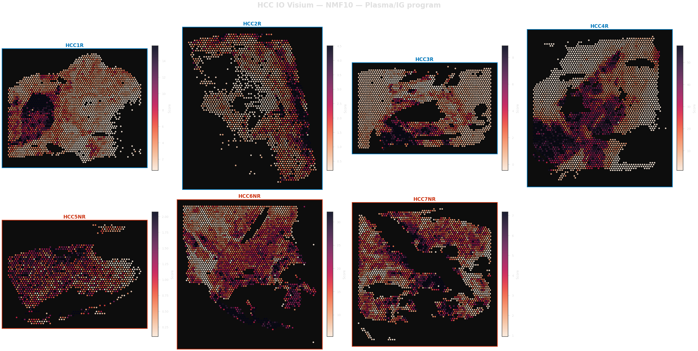
#### `figures/02z_visium_nmf2.png`

Auxiliary diagnostic figure produced by the corresponding analysis script. See `scripts/` and `results_index.yaml` for provenance.

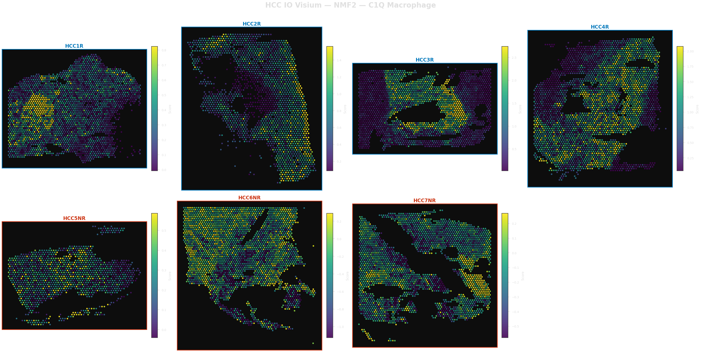
#### `figures/02z_visium_nmf4.png`

Auxiliary diagnostic figure produced by the corresponding analysis script. See `scripts/` and `results_index.yaml` for provenance.

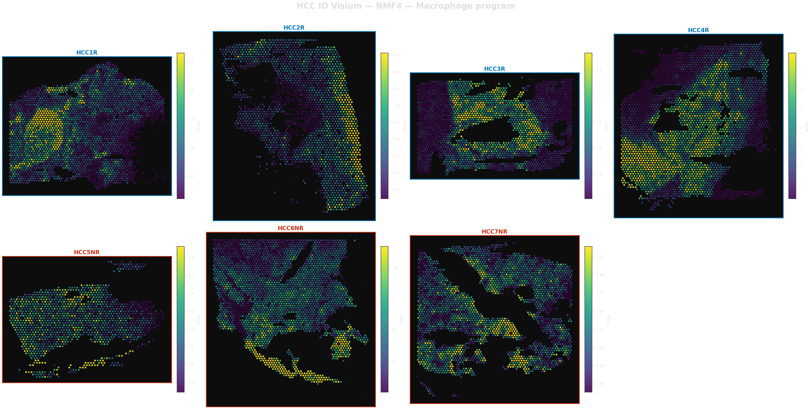
#### `figures/02z_visium_t_cell_exhaustion.png`

Auxiliary diagnostic figure produced by the corresponding analysis script. See `scripts/` and `results_index.yaml` for provenance.

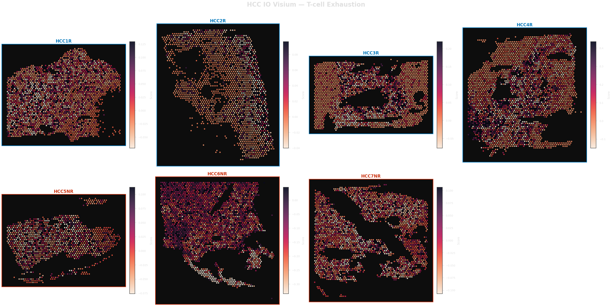
#### `figures/02z_visium_tfh_like.png`

Auxiliary diagnostic figure produced by the corresponding analysis script. See `scripts/` and `results_index.yaml` for provenance.

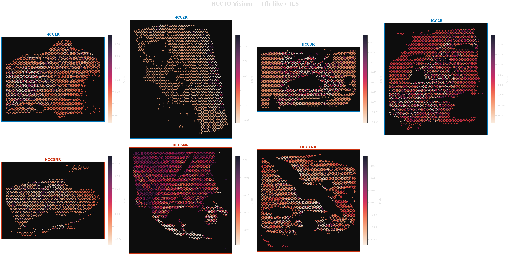
