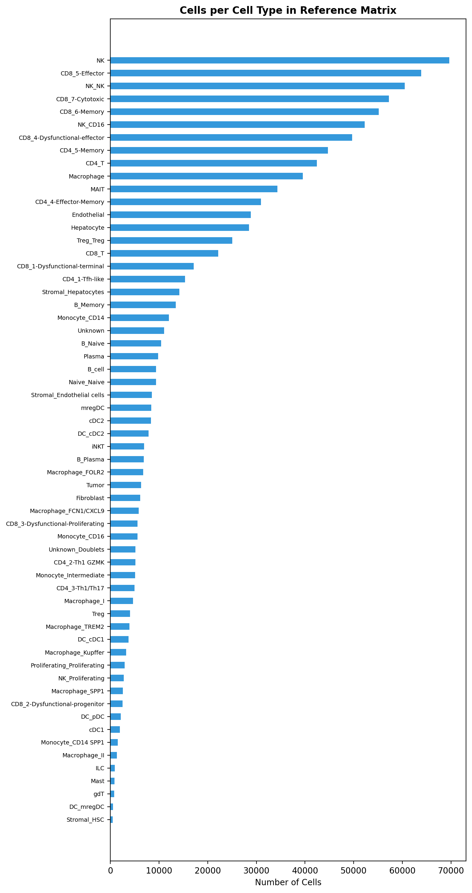
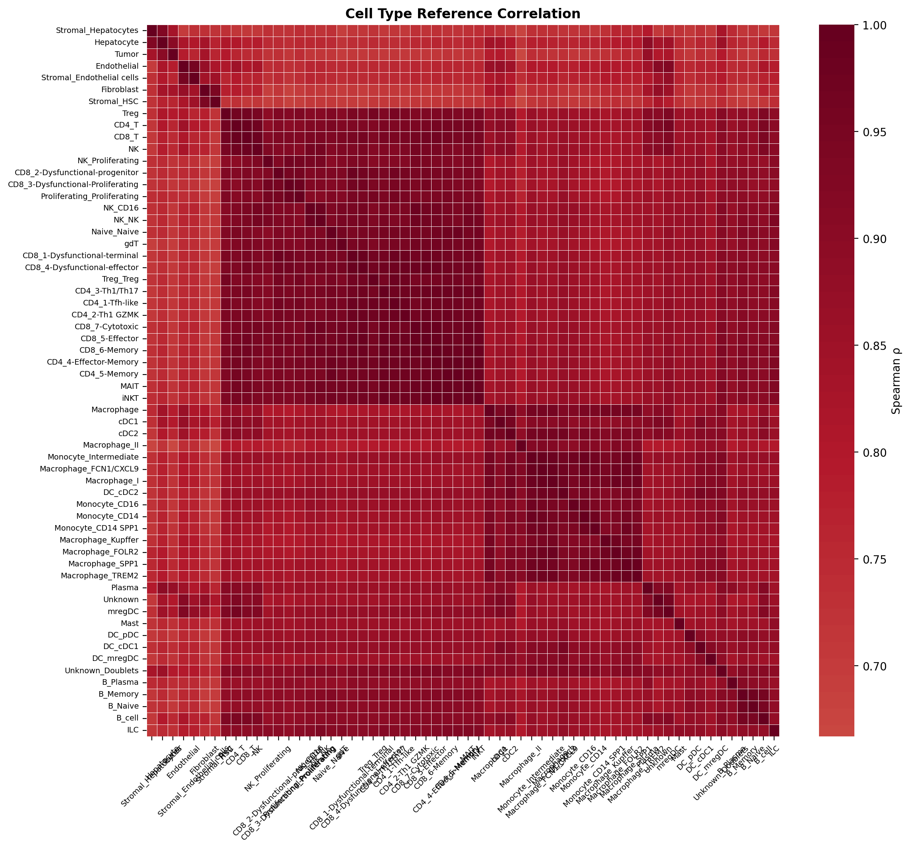
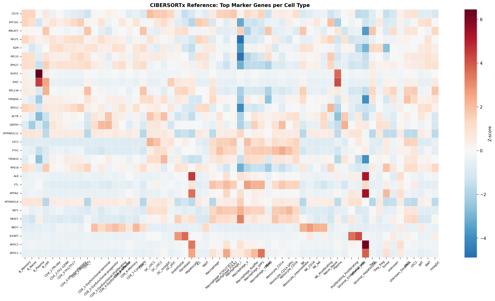
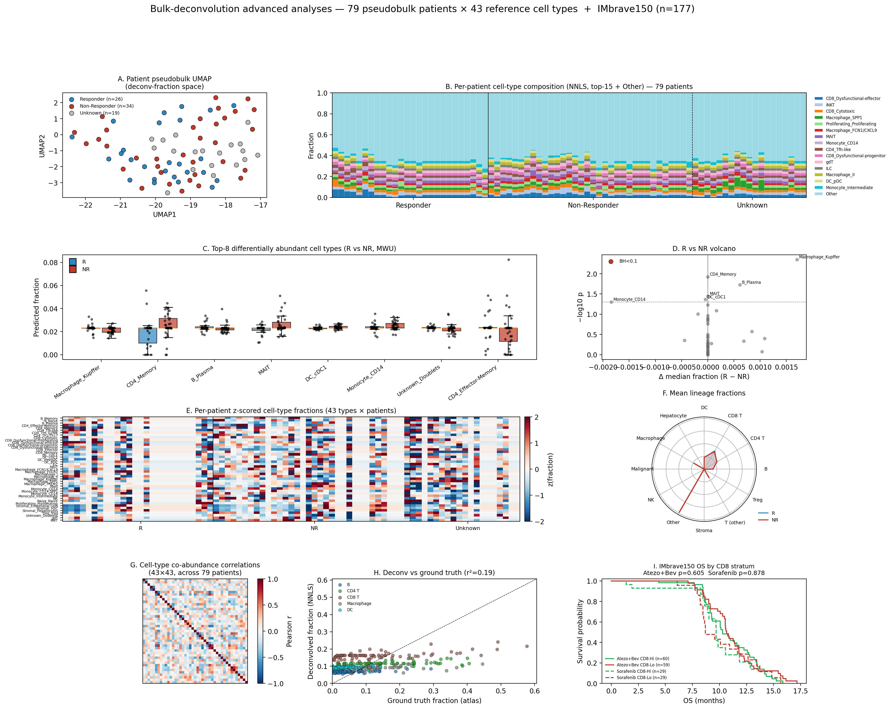
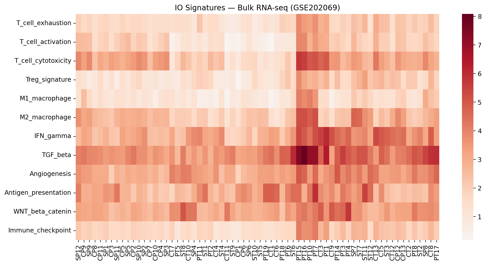
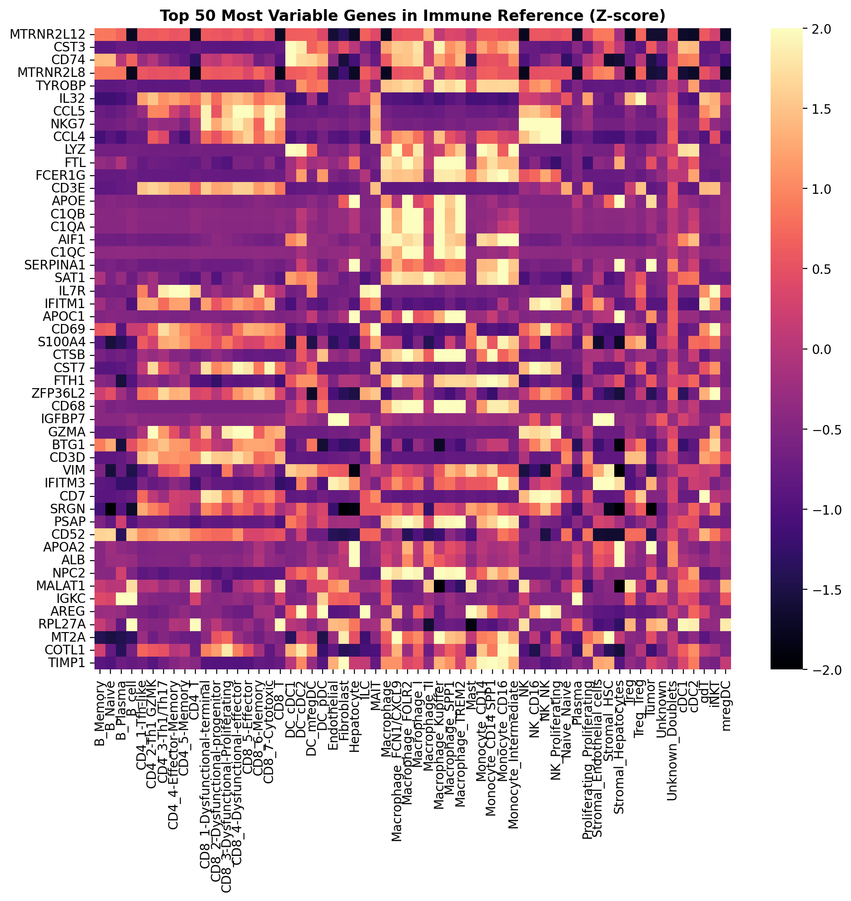

# Figures interpretation — `out/02c_bulk_deconvolution`

> Companion to `docs/manuscript.md` (May 2026 revision). All R-vs-NR
> statistics, AUCs and effect sizes referenced below are computed at the
> patient level on the GSE206325 anti-PD-1 discovery cohort (n=24; 7 R,
> 17 NR) unless otherwise stated. External validation uses the Cappuyns
> et al. 2023 atezolizumab + bevacizumab cohort (n=32 evaluable; 19 R,
> 13 NR). Statistics use two-sided Mann–Whitney U with BH-FDR within
> family, Cliff's δ for effect size, and 2,000-iteration patient-level
> bootstrap 95 % CIs.

## Scope
Pseudobulk and CIBERSORTx-style deconvolution of the integrated atlas (79 patients × 15,697 genes), with cross-trial projection onto IMbrave150.

## Figure-by-figure interpretation

### `figures/`
#### `figures/02c_reference_cellcounts.png`

CIBERSORTx-style reference: cell counts per signature cell type used to build the 43-class reference matrix.

#### `figures/02c_reference_correlation.png`

Reference-matrix cell-type correlation heatmap — confirms low cross-cell-type collinearity.

#### `figures/02c_reference_heatmap.png`

Reference signature matrix heatmap (15,853 genes × 60 sub-types).

#### `figures/bulk_deconv_advanced_composite.png`

Nine-panel bulk deconvolution composite: UMAP, stacked composition, box plots, volcano, heatmap, radar, co-abundance, deconv-vs-truth, KM (§P3 of the project memory).

#### `figures/bulk_io_heatmap.png`

Bulk IO-signature heatmap projected from the atlas onto pseudobulk samples (79 patients × 15,697 genes).

#### `figures/eda_highly_variable_genes_heatmap.png`

Exploratory HVG heatmap supporting the pseudobulk normalisation.

