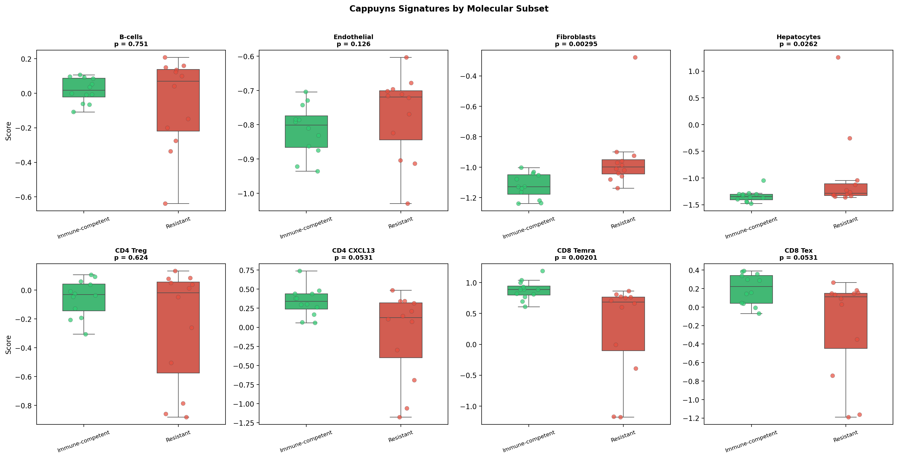
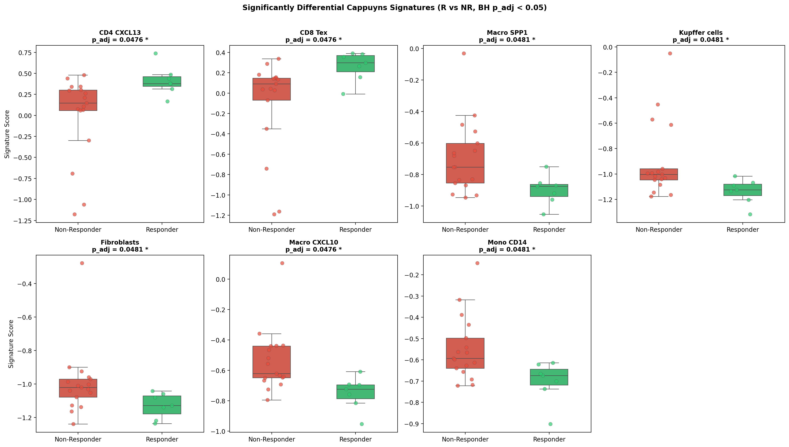
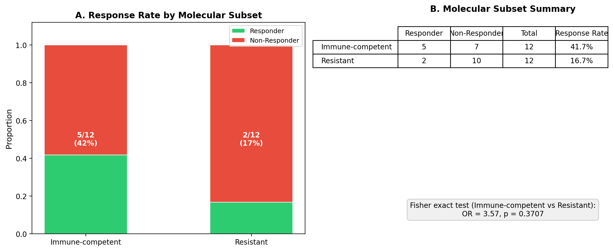
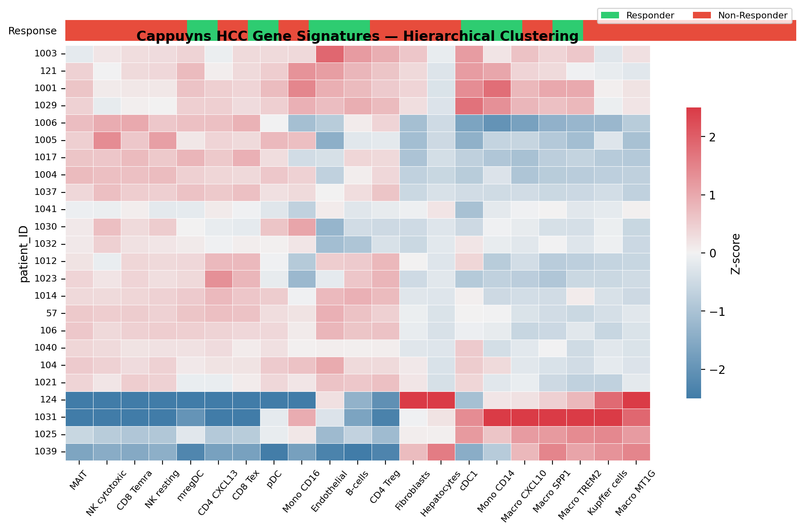

# Figures interpretation — `out/02i_cappuyns_signatures`

> Companion to `docs/manuscript.md` (May 2026 revision). All R-vs-NR
> statistics, AUCs and effect sizes referenced below are computed at the
> patient level on the GSE206325 anti-PD-1 discovery cohort (n=24; 7 R,
> 17 NR) unless otherwise stated. External validation uses the Cappuyns
> et al. 2023 atezolizumab + bevacizumab cohort (n=32 evaluable; 19 R,
> 13 NR). Statistics use two-sided Mann–Whitney U with BH-FDR within
> family, Cliff's δ for effect size, and 2,000-iteration patient-level
> bootstrap 95 % CIs.

## Scope
Signature-scoring outputs on the Cappuyns et al. 2023 atezolizumab + bevacizumab external validation cohort (32 response-evaluable patients, 19 R / 13 NR; pre-treatment week-0 biopsies).

## Figure-by-figure interpretation

### `figures/`
#### `figures/cappuyns_immune_status_comparison.png`

Cappuyns 2023 immune-status comparison: per-patient IO signature means across R/NR/excluded subsets.

#### `figures/cappuyns_key_signatures_response.png`

Per-signature R-vs-NR boxplots in the Cappuyns cohort.

#### `figures/cappuyns_molecular_subsets.png`

Cappuyns molecular sub-set assignment via the discovery signature panel.

#### `figures/cappuyns_signature_heatmap.png`

Per-patient signature heatmap on the Cappuyns external cohort.

