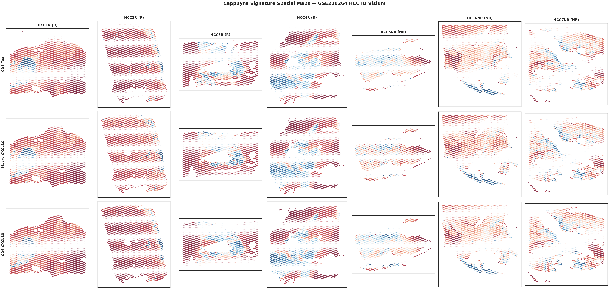
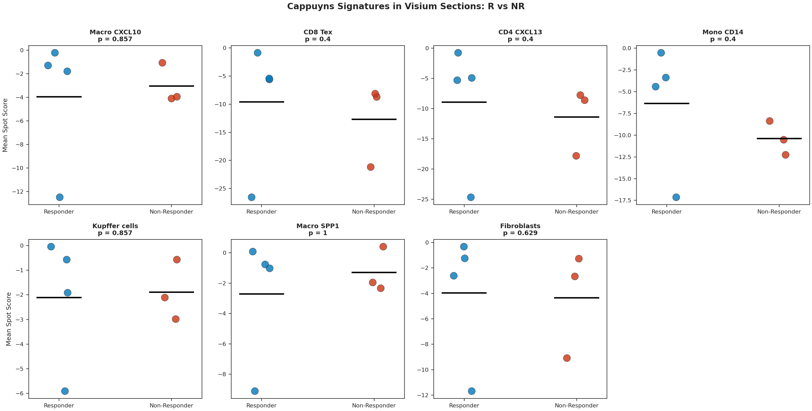

# Figures interpretation — `out/02k_cappuyns_spatial`

> Companion to `docs/manuscript.md` (May 2026 revision). All R-vs-NR
> statistics, AUCs and effect sizes referenced below are computed at the
> patient level on the GSE206325 anti-PD-1 discovery cohort (n=24; 7 R,
> 17 NR) unless otherwise stated. External validation uses the Cappuyns
> et al. 2023 atezolizumab + bevacizumab cohort (n=32 evaluable; 19 R,
> 13 NR). Statistics use two-sided Mann–Whitney U with BH-FDR within
> family, Cliff's δ for effect size, and 2,000-iteration patient-level
> bootstrap 95 % CIs.

## Scope
Section-level signature heatmaps from the Cappuyns spatial sub-cohort, used to test cross-platform program coherence.

## Figure-by-figure interpretation

### `figures/`
#### `figures/cappuyns_spatial_heatmaps.png`

Cappuyns spatial sub-cohort signature heatmaps.

#### `figures/cappuyns_spatial_section_comparison.png`

Per-section comparison of immune programmes in the Cappuyns spatial subset.

