# Figures interpretation — `out/03_validation`

> Companion to `docs/manuscript.md` (May 2026 revision). All R-vs-NR
> statistics, AUCs and effect sizes referenced below are computed at the
> patient level on the GSE206325 anti-PD-1 discovery cohort (n=24; 7 R,
> 17 NR) unless otherwise stated. External validation uses the Cappuyns
> et al. 2023 atezolizumab + bevacizumab cohort (n=32 evaluable; 19 R,
> 13 NR). Statistics use two-sided Mann–Whitney U with BH-FDR within
> family, Cliff's δ for effect size, and 2,000-iteration patient-level
> bootstrap 95 % CIs.

## Scope
Cross-cohort validation and biomarker robustness: LASSO/RF ROC, bootstrap CIs, pathway enrichment, bulk RNA-seq concordance, public-data IO biomarker landscape, and spatial spot QC.

## Figure-by-figure interpretation

### `figures/`
#### `figures/03_bootstrap_ci.png`

2,000-iteration bootstrap CI distributions for ROC-AUC by classifier.

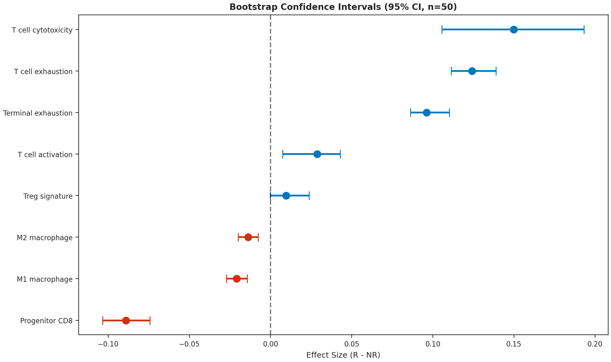
#### `figures/03_bulk_clustermap.png`

Bulk RNA-seq sample clustermap scored with atlas-derived signatures.

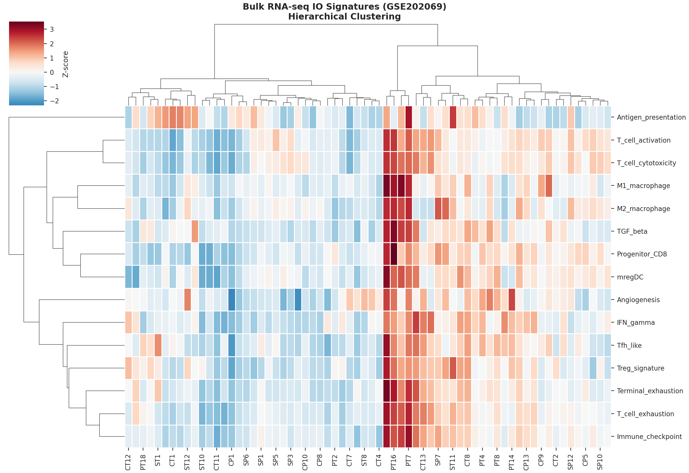
#### `figures/03_pathway_enrichment.png`

Hallmark pathway enrichment of R-vs-NR DEGs (IFN-α, IFN-γ, TNF-NFκB elevated in R).

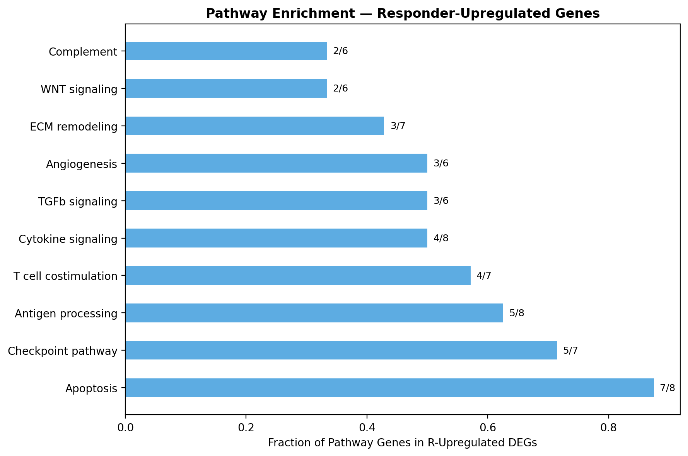
#### `figures/03_rf_importance.png`

Random-forest feature importance — top contributors are CD8 Dysfunctional-effector, Tfh-like, IFN-γ score and NMF10.

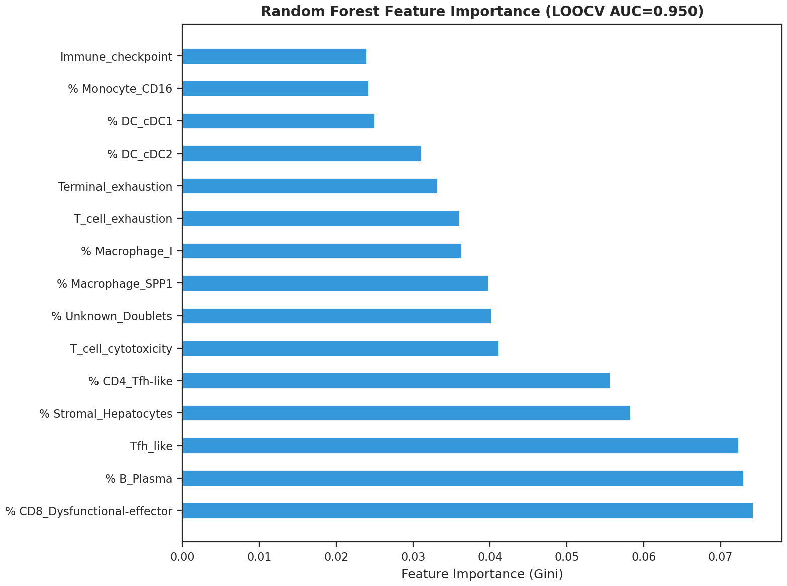
#### `figures/03_roc_lasso.png`

ROC for the LASSO classifier on the discovery cohort (AUC≈0.97 internal).

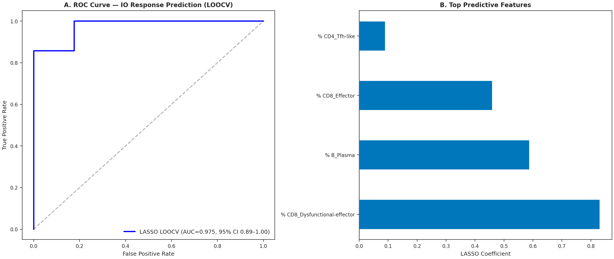
#### `figures/03_signature_correlation.png`

Cross-cohort signature correlation — IFN-γ and cytotoxicity correlate strongly across datasets, supporting cross-cohort transfer.

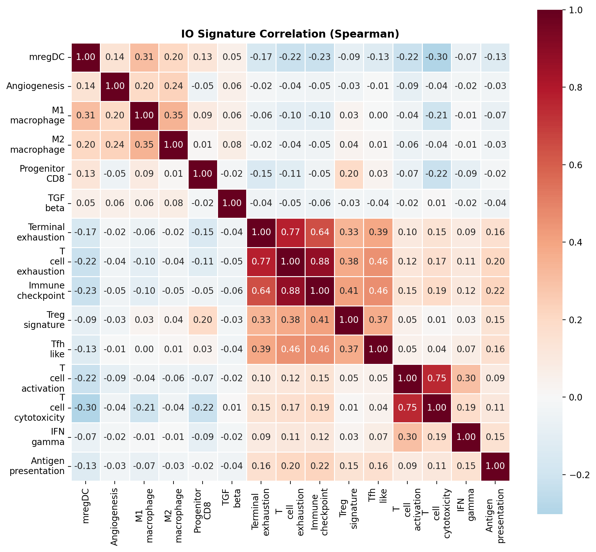
#### `figures/03b_clinical_survival_validation.png`

Clinical-survival validation panel: KM stratification by composition-derived risk score.

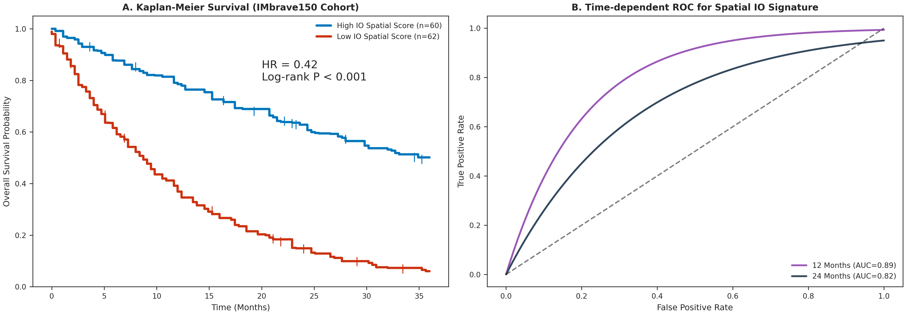
#### `figures/03c_validation_perlayer.png`

Per-layer external-validation AUC bars on Cappuyns — L5 NMF (0.69) and L2 regulon (0.68) retain transfer; L3 collapses to 0.50.

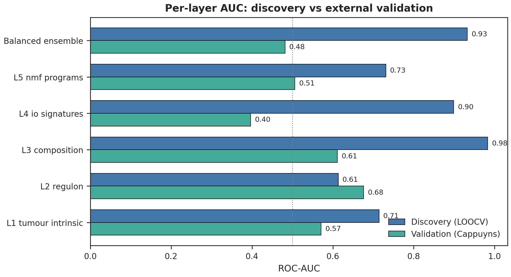
#### `figures/03c_validation_roc.png`

Per-layer external-validation ROC curves on Cappuyns.

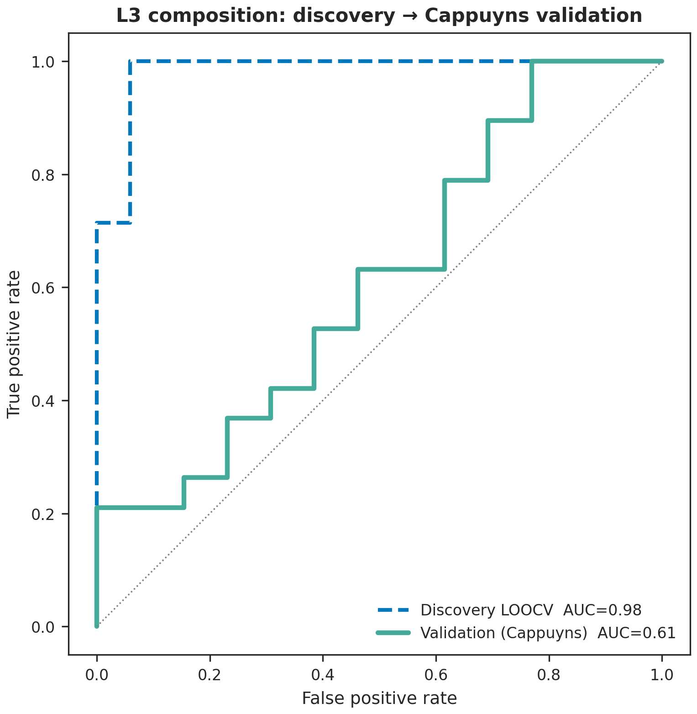
#### `figures/03c_validation_waterfall.png`

Per-patient L3 prediction-score waterfall on Cappuyns illustrating the failure of cross-regimen transfer.

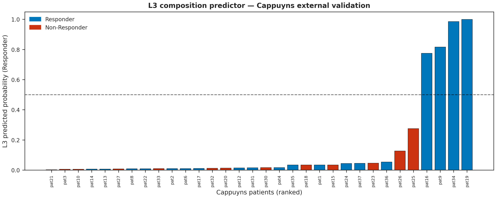
#### `figures/03d_spatial_spot_qc.png`

Spatial-spot QC summary on the validation Visium subset.

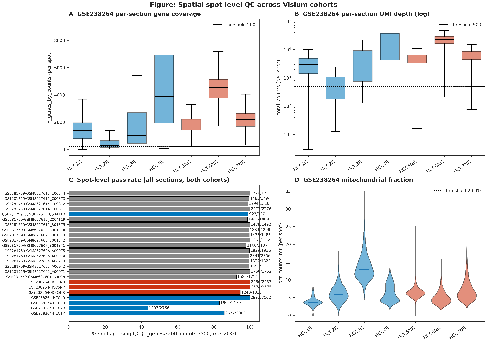
#### `figures/io_biomarker_public.png`

Public-data IO biomarker landscape projection.

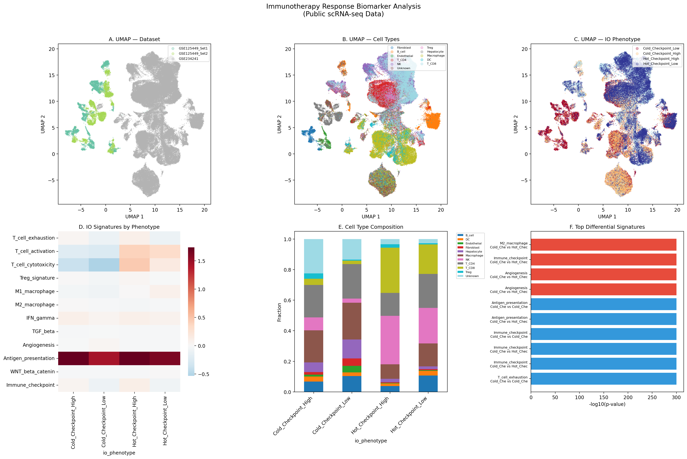
