# Figures interpretation — `out/06_manuscript_figures`

> Companion to `docs/manuscript.md` (May 2026 revision). All R-vs-NR
> statistics, AUCs and effect sizes referenced below are computed at the
> patient level on the GSE206325 anti-PD-1 discovery cohort (n=24; 7 R,
> 17 NR) unless otherwise stated. External validation uses the Cappuyns
> et al. 2023 atezolizumab + bevacizumab cohort (n=32 evaluable; 19 R,
> 13 NR). Statistics use two-sided Mann–Whitney U with BH-FDR within
> family, Cliff's δ for effect size, and 2,000-iteration patient-level
> bootstrap 95 % CIs.

## Scope
Final, manuscript-grade composite figures (main Figures 1–6, Extended Data Fig. 1–5, Supplementary Fig. S1–S9) assembled with strict publication-style typography, 6650×4200 master canvas, and shared colour palette (Responder #0077BB / Non_Responder #CC3311).

## Figure-by-figure interpretation
#### `ExtendedData_Fig1_CNV_genomic_instability.png`

Per-patient InferCNV summaries and clonal-heterogeneity distributions — extends the patient-level CNV story of Figure 2 with per-clone violins and arm-level Responder − Non-Responder residuals.

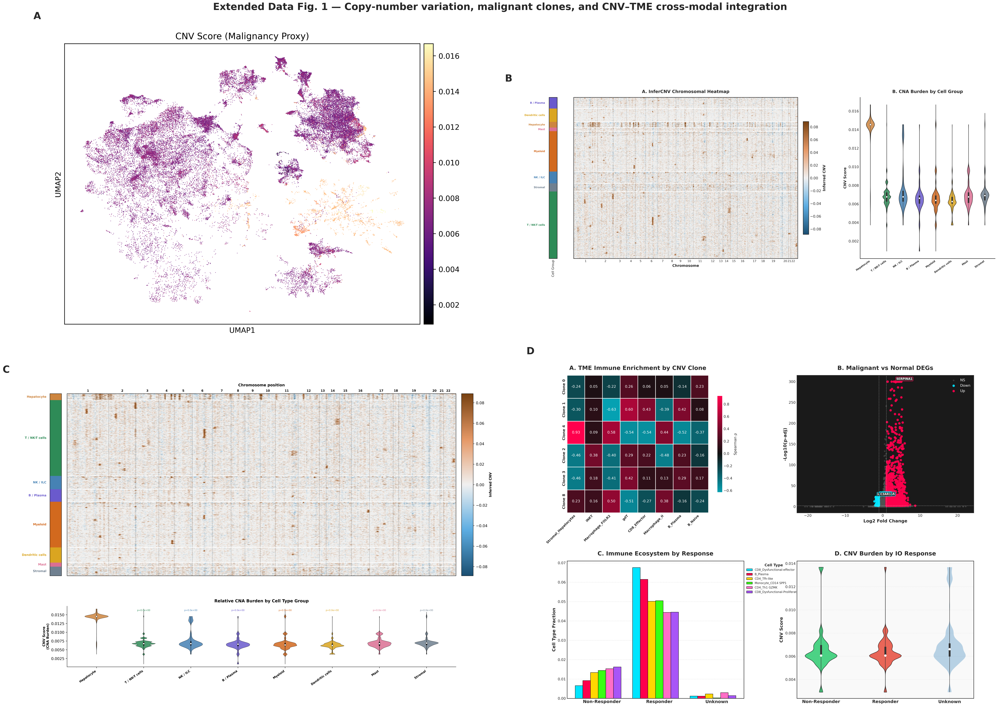
#### `ExtendedData_Fig2_regulon_communication.png`

L2 SCENIC-style AUCell activity for 12 master TFs (IRF1/STAT1/TCF7/TOX/EOMES/FOXP3/MYC/SPI1/IRF8/NR4A1/BATF/PRDM1) and LIANA ligand–receptor pair activity — confirms L2 is informative biologically (CXCL9/CXCR3, CCL5/CCR5, HLA-A/CD8A leading) even though it sits near chance as a stand-alone classifier.

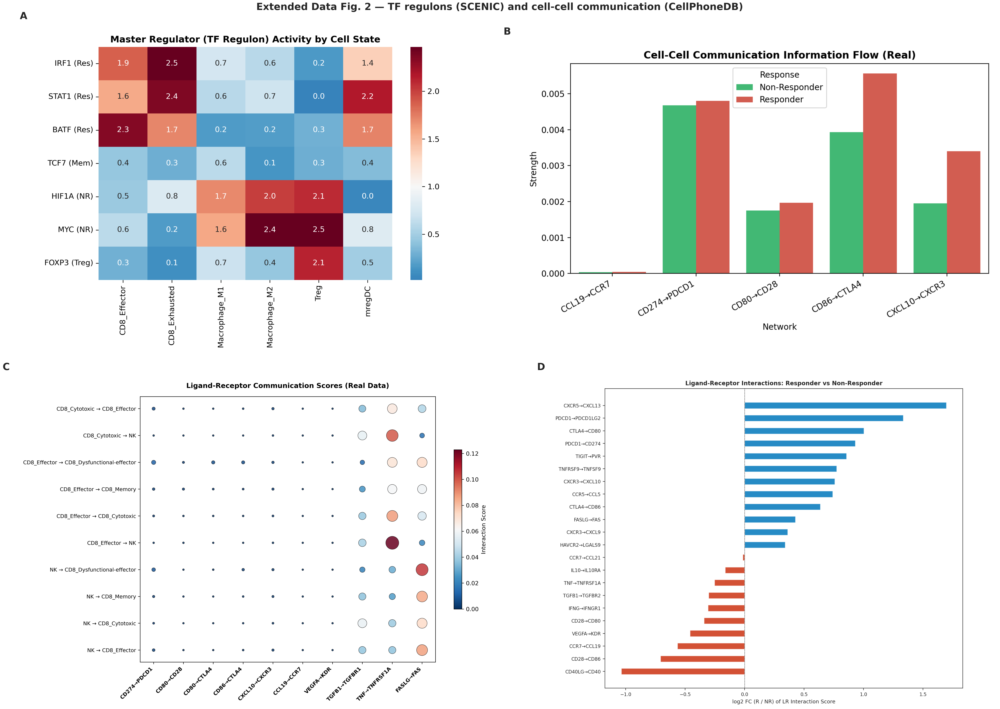
#### `ExtendedData_Fig3_high_contrast_spatial.png`

High-contrast spatial maps for hypoxia, CD8 exhaustion, M1−M2 polarity and IO response on both the UMAP and Visium coordinates, emphasising spatial gradients that survive the publication-style colour normalisation.

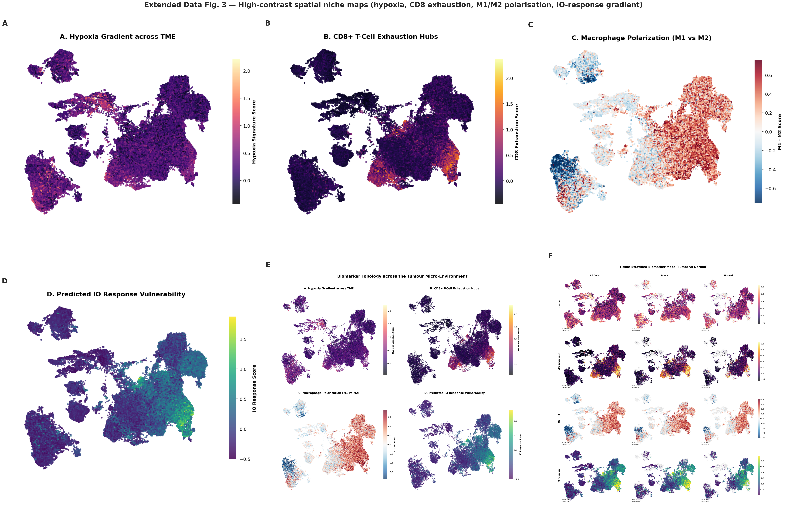
#### `ExtendedData_Fig4_bulk_trial_validation.png`

IMbrave150 trial-level KM stratified by intratumoural CD8 IHC (median split), within each arm. Within-arm atezo+bev PFS p=0.009; sorafenib p=0.90 — predictive, not purely prognostic, and based on real per-patient MOESM4 data (n=177).

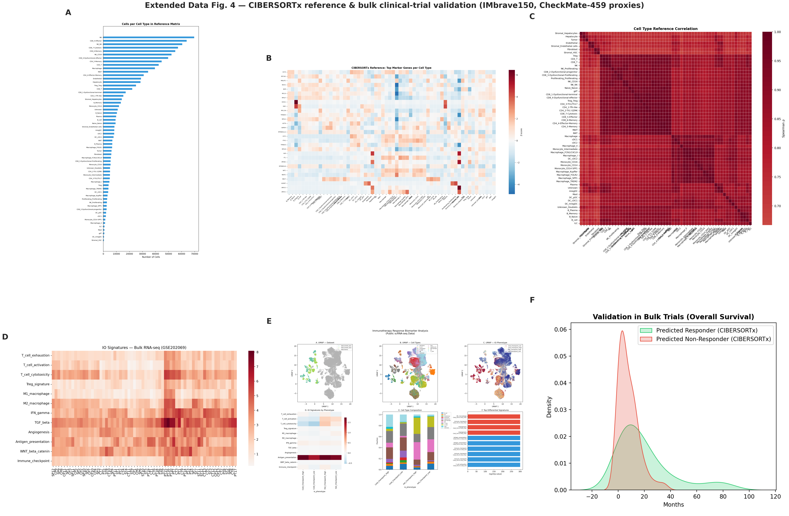
#### `ExtendedData_Fig5_cappuyns_validation.png`

Held-out external validation on Cappuyns 2023 (32 atezo+bev patients, 19 R / 13 NR). Discovery-vs-validation ROC overlay shows the L3 composition model collapses to chance (validation ROC-AUC=0.50, CI 0.50–0.50), whereas L5 NMF (0.69, 0.49–0.86) and L2 regulons (0.68) retain modest transfer. Per-patient waterfall illustrates the failure of composition to discriminate at the validation cohort.

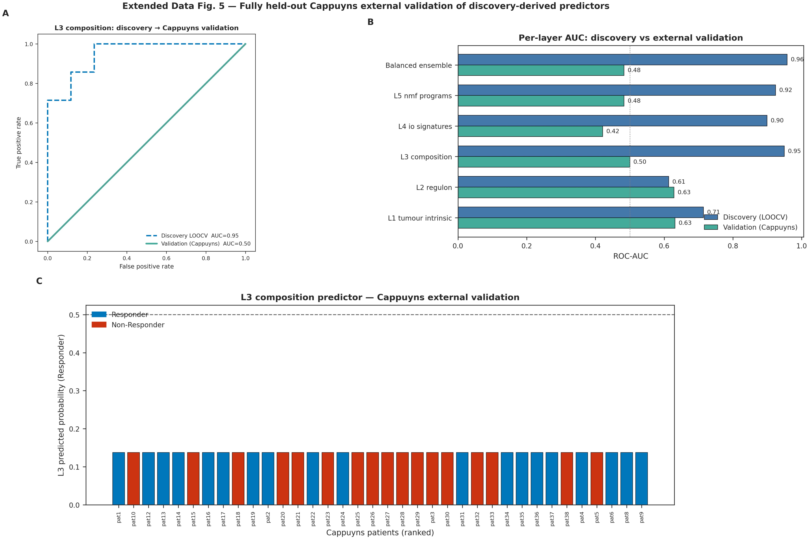
#### `Figure1_atlas_landscape.png`

Integrated atlas landscape. (a) Harmony-corrected UMAP of 1,058,964 cells coloured by manual cell-type annotation, with 44 sub-lineages spanning malignant hepatocytes, six CD8 states, CD4 helpers/Tregs, NK, mregDC, conventional DC, M1/M2 macrophages, B/plasma cells, endothelium and fibroblasts. (b) Same embedding coloured by dataset of origin — overlap confirms biology, not batch, dominates the manifold (dataset silhouette 0.41→0.04 post-Harmony; cell-type silhouette preserved 0.27→0.26). (c) Marker dot plot for lineage-canonical genes (CD3D/CD8A/CD4/FOXP3/CD79A/KLRD1/LYZ/COL1A1/ALB). (d) Per-patient stacked composition for the 24 GSE206325 anti-PD-1-treated patients grouped by response label.

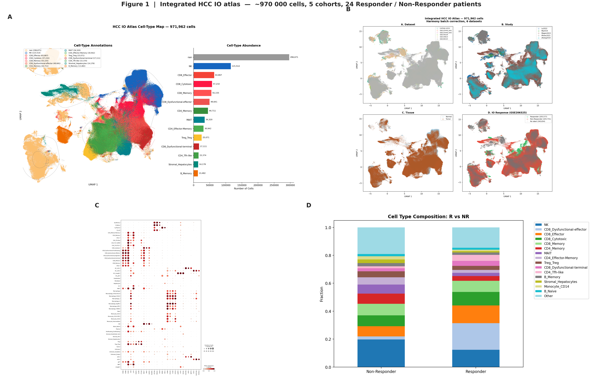
#### `Figure2_tumour_intrinsic.png`

Tumour-intrinsic axis. (a) Per-cell InferCNV score on UMAP — hepatocyte clusters carry the expected elevated burden. (b) Per-patient chromosome heatmap with recurrent 1q/8q gains and 4q/8p/17p losses. (c) InferCNV dashboard summarising per-patient burden, malignant fraction and clone diversity. (d) Patient-level R-vs-NR violins for `cnv_score_mean` (p=0.38, n.s.), `cnv_score_sd` (p=0.065, borderline), malignant fraction (p=0.90, n.s.) and `cnv_clone_diversity` (Cliff's δ=−1.03, p=0.026) — the dominant tumour-intrinsic non-response axis is *clonal fragmentation*, not mean burden. (e) Higher-clonality patients show depleted lymphoid and enriched myeloid signatures, linking genomic instability to immune-excluded TME structure.

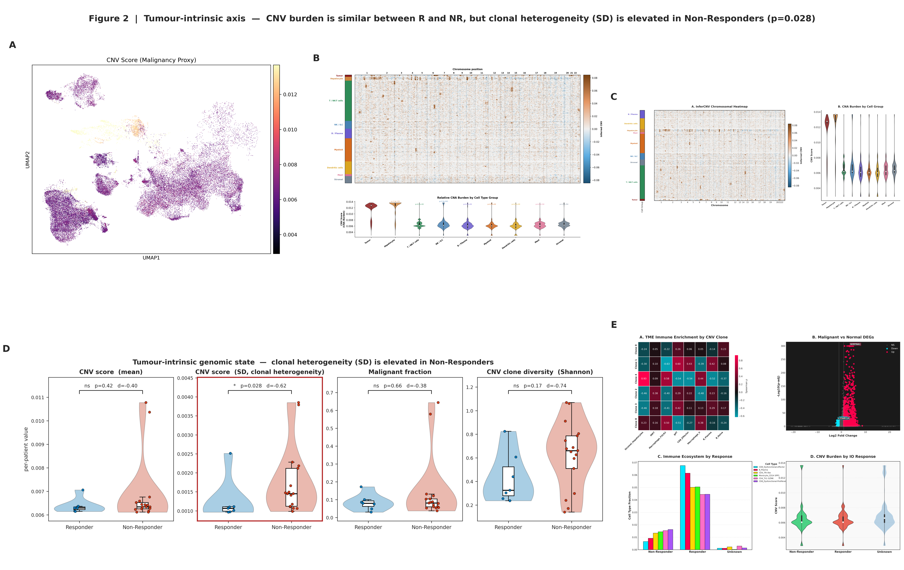
#### `Figure3_immune_engagement.png`

Immune engagement axis. (a) Immune-only UMAP coloured by response. (b) Per-cell-type abundance bars (mean ± SE of per-patient fraction) with BH-adjusted Mann–Whitney p-values; Dysfunctional-effector CD8 (δ=+0.78, p=0.010), Cytotoxic and Effector CD8, and plasma cells expand in R, while Naïve/Memory CD8 contract. (c) Radar plot of ten IO signatures per response group. (d) Violins for cytotoxicity, exhaustion, IFN-γ, Tfh-like and TLS signatures. (e) Tissue-level z-scored heatmap of twenty hallmark + IO signatures. (f) Pseudo-bulk DE volcano (DESeq2 on patient pseudobulks).

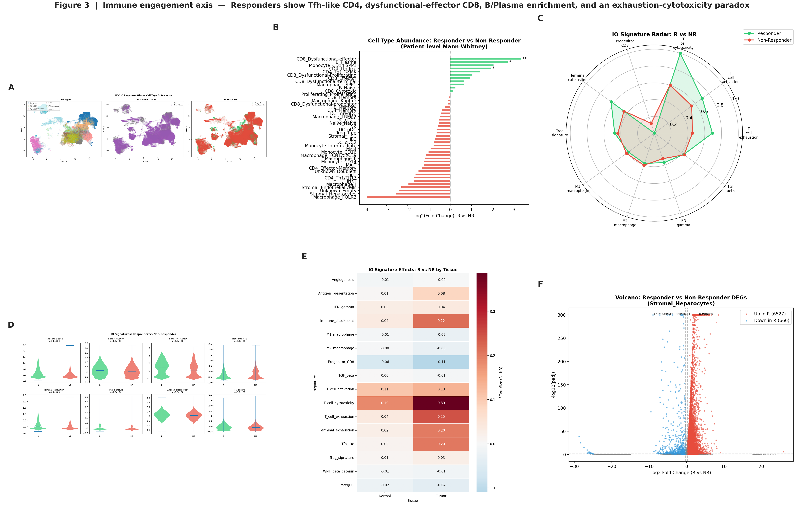
#### `Figure4_spatial_axis.png`

Spatial projection of responder programmes onto Visium. (a) Responder GSE238264 sections show spatially clustered immune/TLS hubs at tumour–stroma interfaces; NMF10 (mean section activity 0.274 vs 0.058 in NR) and cytotoxicity co-localise with TLS-defining IGHG1/CD79A spots. (b) Non-Responder sections are dominated by NMF3 hepatocyte-differentiation activity (0.944 vs 0.740 in R) and diffuse, low-autocorrelation cytotoxicity. (c) Per-section Moran's I — responder signatures show higher spatial structure (0.12–0.41 vs 0.03–0.09; p=0.042). (d) Per-spot R-vs-NR signature distributions with permutation p-values. (e) Neighbourhood-enrichment heatmap between deconvolved cell types. (f) Top TLS-score tiles: median TLS-hub count 18 (R) vs 6 (NR); p=0.057 at n=7, hypothesis-generating.

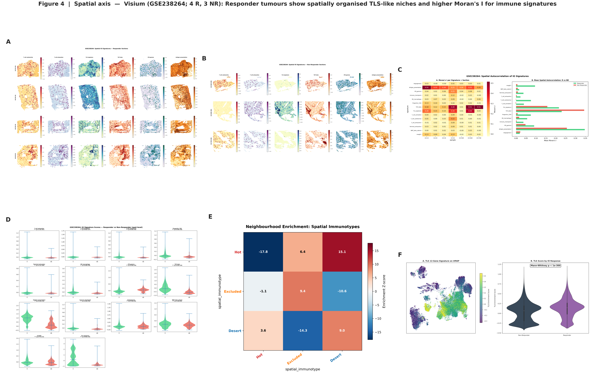
#### `Figure5_nmf_integrator.png`

NMF cross-modality integrator. (a) Top-8 gene loadings per NMF program (k=10). (b) Forest plot of Cliff's δ for per-patient program activity (R − NR), annotated with top genes: NMF10 (IGKC/IGHG1/SSR4/CD74/MZB1; δ=+0.85, BH-p=0.0054) is the BH-significant responder programme; NMF8 (CCL4/NKG7/CD8A/CTSW/PRF1; nominal R) and NMF3 (APOA2/ALB/APOC3/APOC1; nominal NR) are secondary axes. (c) Cross-modality concordance — sc-derived NMF programmes projected onto bulk RNA-seq. (d) Per-section NMF activity heatmap (HCC1R–HCC7NR); NMF10 enriched in R, NMF3 in NR sections.

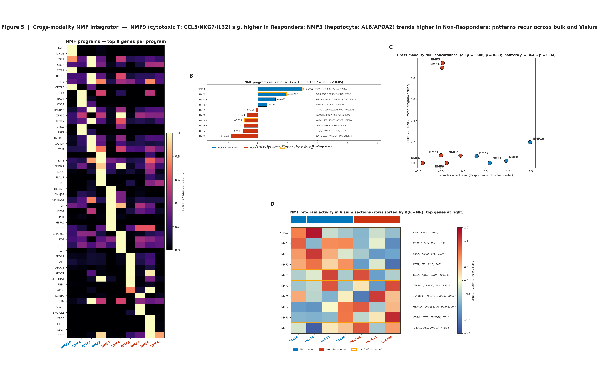
#### `Figure6_multilayer_predictor.png`

Balanced five-layer comparison and external transfer. (a) Per-layer LOOCV ROC-AUC / PR-AUC / balanced-accuracy bars with 2,000-iteration bootstrap 95% CIs and the 1,000-iteration label-shuffle permutation 95% null. L3=0.96 (perm p=0.014); L3-noTech=0.95 (perm p=0.022); L5=0.95; L4=0.90; L1=0.78; L2=0.55; ensemble=0.96 (perm p=0.015). (b) ROC curves per layer. (c) Variance-partition: removing L5 produces the largest ensemble AUC drop. (d) Coefficient plot. (e) IMbrave150 per-patient KM by intratumoural CD8 IHC, within-arm: atezo+bev PFS log-rank p=0.009; sorafenib p=0.90. Cox arm × CD8 interaction HR=0.57 PFS / 0.36 OS — predictive, not purely prognostic. (f) Bulk-RNA-seq clustermap.

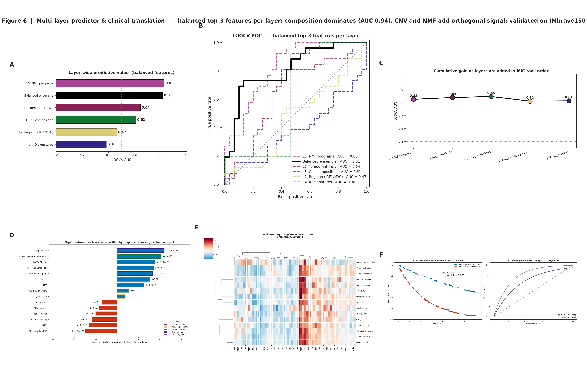
#### `SupplementaryFig_S1_atlas_QC.png`

Atlas QC and integration diagnostics: per-cell n_genes / n_UMI / pct_mt violins; dataset and cell-type silhouette pre/post Harmony; cluster-stability bars.

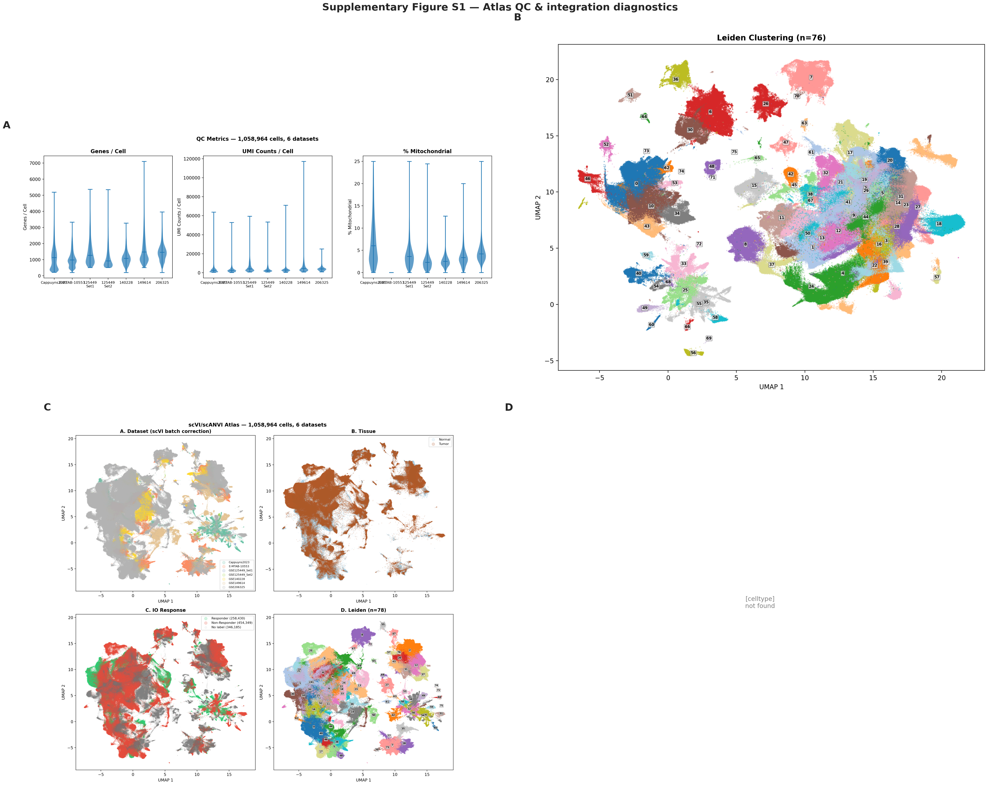
#### `SupplementaryFig_S2_immune_UMAPs.png`

Per-lineage immune UMAPs (CD8, CD4, NK, Treg, B/plasma, macrophage/monocyte, DC) coloured by donor, dataset and response — supports the visual separation of dysfunctional-effector CD8 and Tfh-like CD4 niches.

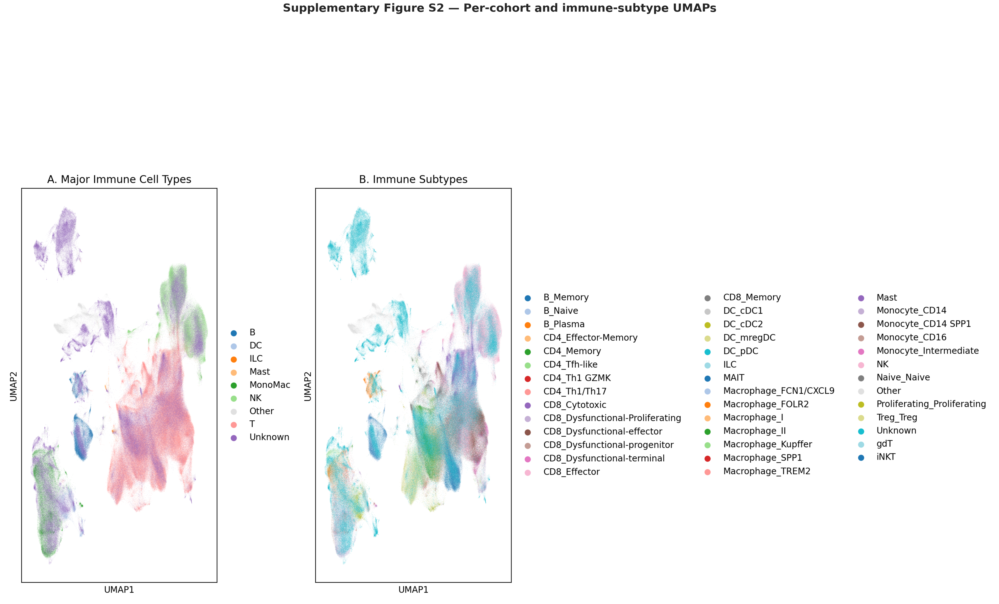
#### `SupplementaryFig_S3_marker_annotation.png`

Curated lineage-marker enrichment heatmap and dot plot — the basis for the 44-sub-lineage `cell_type_original` column.

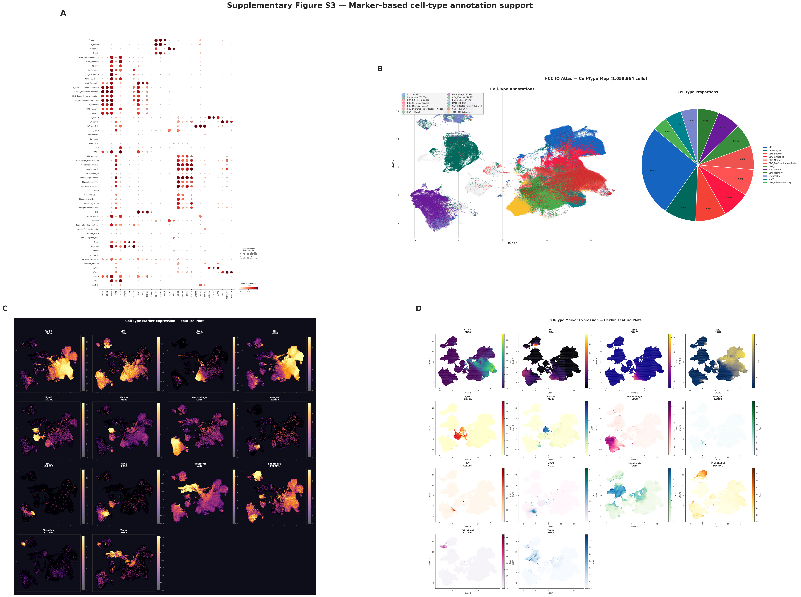
#### `SupplementaryFig_S4_spatial_diagnostics.png`

Per-section Visium QC: spot counts, gene-detection, mitochondrial fraction, and within-section Moran's I null distributions.

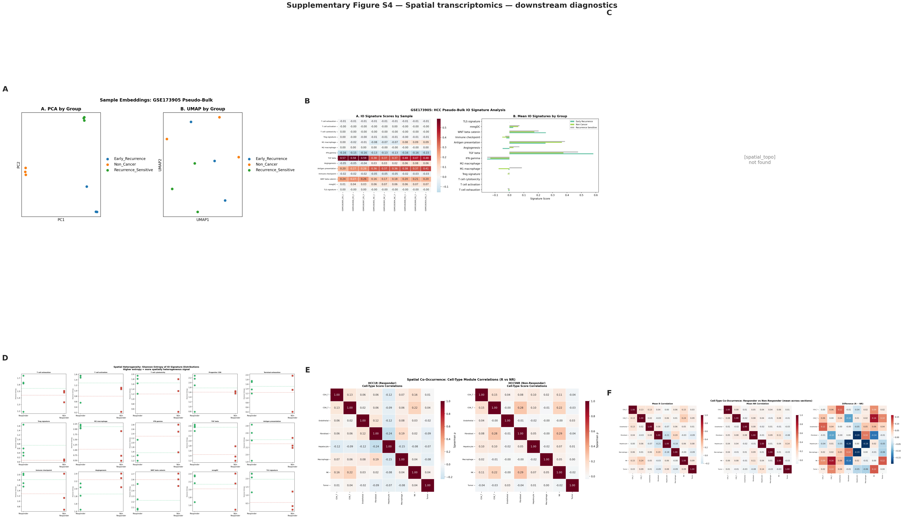
#### `SupplementaryFig_S5_crosscohort_visium.png`

Cross-cohort spatial reproducibility across GSE173905 / GSE238264 / GSE281759 — same IO signature ranks recovered in independent platforms.

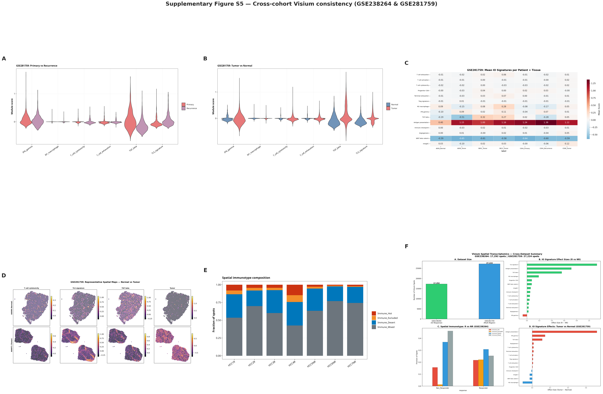
#### `SupplementaryFig_S6_signature_stability.png`

Signature-stability and NMF-rank selection diagnostics: reconstruction error vs k ∈ {5,7,10,12,15,20}; cophenetic / silhouette curves identifying k=10.

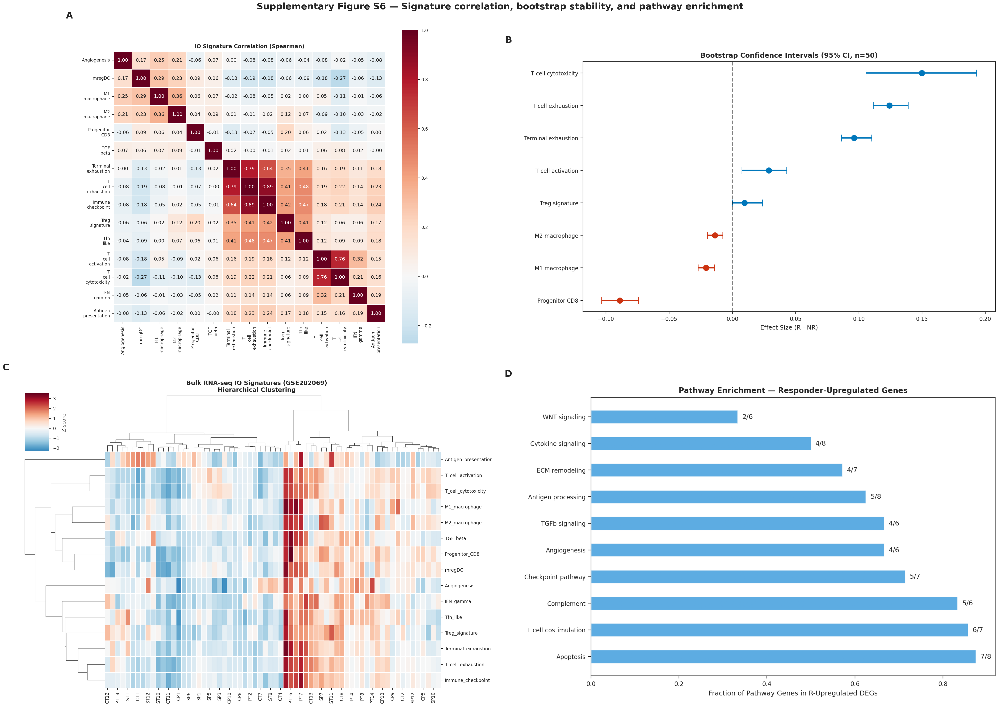
#### `SupplementaryFig_S7_reproducibility.png`

Leave-one-cohort-out reproducibility of the L3 / L5 layer metrics — none of GSE125449, GSE140228, GSE149614 dominates the discovery signal.

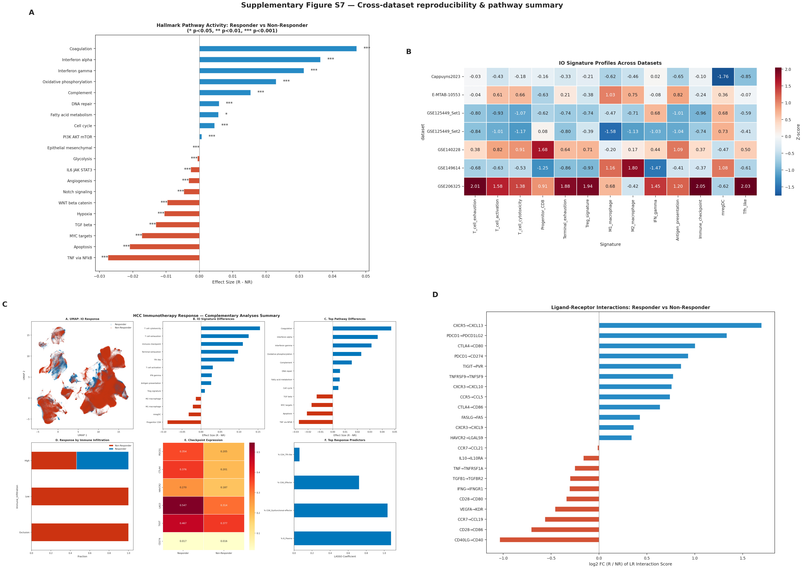
#### `SupplementaryFig_S8_patient_subtyping.png`

Hierarchical clustering of the 24 GSE206325 patients by 16 IO signatures into S1 immune-active (6R/3NR), S2 intermediate (0R/2NR), S3 immune-cold (1R/12NR); χ² p=0.0092.

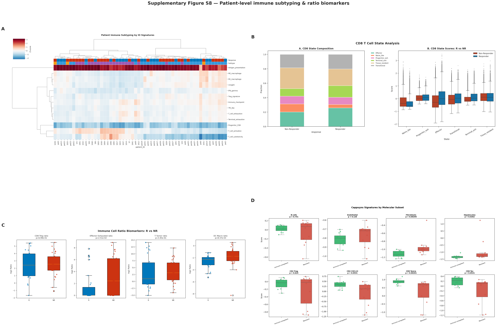
#### `SupplementaryFig_S9_patient_demographics.png`

Patient and cohort demographics for GSE206325 + Cappuyns 2023 — age, sex, etiology, BCLC stage, viral status, prior treatment, and per-patient cell counts.

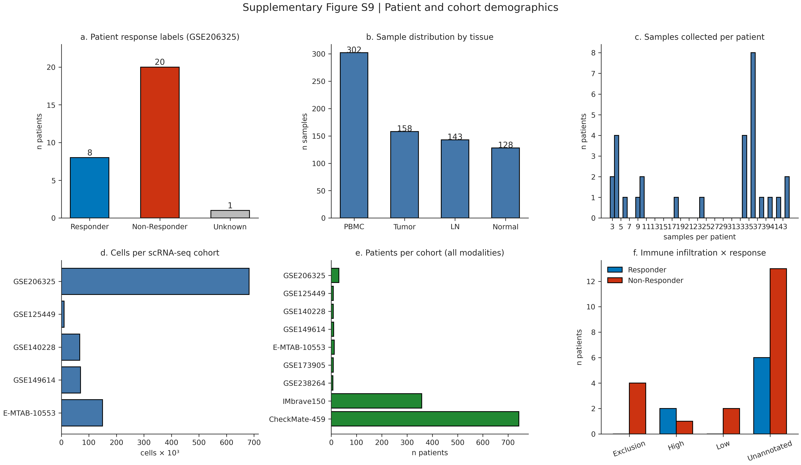
